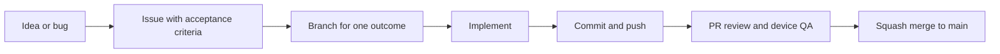

# Development workflow

GitHub repository: [avellir/Cal-Ai](https://github.com/avellir/Cal-Ai). `main` is the integration branch. Work moves through an issue, a short-lived branch, a pull request, verification and a squash merge.



## Start one task

Choose one issue with a demonstrable outcome. A small bug can go straight into an implementation task. For a multi-session feature, agree the decisions in a parent spec and split it into complete slices with explicit blockers. Each slice includes the UI/service/backend changes needed to demonstrate its outcome.

Use GitHub Issues for task scope, acceptance criteria, blockers and status. [priority.md](priority.md) records product order and links to the work; it is not a second daily task board. Active work is limited to one issue per person or agent. An optional GitHub Project can show Backlog, Ready, In progress, In review and Done; a project board is not required to start.

From a clean working tree:

```powershell
git switch main
git pull --ff-only origin main
git switch -c feat/123-retry-failed-ingredients
```

Use `feat/<issue>-<description>`, `fix/<issue>-<description>` or `chore/<issue>-<description>`. While a branch is active, make small commits after coherent working changes and push at session boundaries. Start new work from current `main` after the previous PR merges.

Keep existing uncommitted work on its branch while recovering it. Use a separate worktree for an unrelated task:

```powershell
git fetch origin
git worktree add ../Cal-Ai-workflow -b chore/123-workflow origin/main
```

## Testing schedule

Tests and other executable checks are opt-in, following the user's preference:

- Run them when explicitly requested. A request for a focused test authorizes that scope, not an automatic full verification run.
- A clear end-of-day cue such as "I'm done for today" authorizes one batched daily verification session. Run the relevant checks for accumulated untested changes; reuse still-applicable results for unchanged source rather than repeating a full run without reason.
- Routine questions, programming edits, commits, PR creation/merging and session handoffs do not trigger tests, typecheck, lint, builds or exports. Do not add automatic hooks or scheduled checks without an explicit request.
- Keep untested changes and the last actual results visible in the handoff and PR. Use "Not rerun, per requested testing schedule" where appropriate. Completion of coding or a merge must not be described as a test pass.

During an authorized test session, investigate failures with focused checks. Repeat a full suite only when subsequent changes or unresolved concerns justify it. For a requested full verification session, use Node 24 (see `.nvmrc`) and:

```powershell
npm run verify -- --base origin/main
```

This runs TypeScript, all Jest tests, changed-file lint, the full app/components lint audit, and an iOS JavaScript/assets export. It continues after a failed check so the report shows every result, and exits unsuccessfully if any required check fails. The full lint audit reports existing debt separately; a failing audit is never labeled passed. [Issue #5](https://github.com/avellir/Cal-Ai/issues/5) tracks clearing that debt and making full lint required.

The report is saved locally to `.cleanup-backups/local-checks/latest.json`, with branch, commit, base, a fingerprint of source/config files including uncommitted work, each check's status, and timings. A report is invalid if source changes during the checks. Generated output and reports are ignored by Git. Paste concise results and remaining checks into the PR, identifying the branch/commit and any uncommitted changes that were checked.

Changed-file lint includes committed, staged, unstaged and untracked source files and compares with the branch's merge base. It checks entire touched files, so older lint errors in a touched file can also fail it. Preserve that failure in the report rather than hiding it. For a task branched from another integration branch, pass that actual base instead of `origin/main`.

Verification is local for now; no GitHub Actions workflow is installed by this PR. The runner uses mocked tests and exports without dotenv/provider credentials, live meal writes or paid analysis requests. The export checks bundling; camera, permissions, keyboard, navigation and native behavior still need device QA when affected.

For food-analysis validation requested by the user, compare suitable saved inputs and cover the actual failure. Fresh vision evaluation and live nutrition checks are separate, explicit provider operations. Keep credentials in local ignored environment files or Supabase secrets. Apply migrations and deploy Edge Functions as explicit release steps with the PR's version and validation recorded; a code merge alone does not update Supabase.

## Commit, review and merge

1. Inspect `git status` and the diff. Stage named files belonging to the task; inspect `git diff --cached` before committing. Keep credentials, generated output and unrelated work outside the commit.
2. Commit with a concrete message, for example `fix(nutrition): preserve healthy matches when one detail fails`, and push the branch using `git push -u origin <branch>`.
3. Open a draft PR early if useful. Link its issue with `Closes #123`. Use the PR template to show the change, before/after evidence, checks, release steps and material risks.
4. Review committed work against the issue and the fixed branch base, ideally in a fresh agent session. Check both repository standards and acceptance criteria. Record unperformed device/live checks honestly.
5. Record the last actual validation results, any untested changes and the separately reported full-lint debt. Run new verification only under the testing schedule above. Mark ready after review with that evidence stated honestly. For solo work, the author performs the QA/merge decision; requiring another person's approval is optional when another reviewer is available.
6. Squash merge the PR into `main`, then remove the merged remote branch. Delete a local branch only after checking that it is merged or that its work is preserved. Start the next task from updated `main`.

PR merging and production deployment remain explicit actions. Local verification does not deploy the app or Edge Functions.

## Configure GitHub once

After reviewing the workflow, configure a rule for `main` to require a PR, resolve review conversations, and prevent force pushes and deletion. For a solo repository, use zero mandatory external approvals. Keep squash merge enabled. Local results are evidence for the reviewer; they are not a GitHub-enforced status check. Required hosted checks can be added later if Actions is reinstated.

The templates become the repository defaults when merged. Repository rules and a Project board are separate GitHub settings; neither is configured by these documentation files. Follow [the rollout checklist](docs/workflow/rollout.md).

## Working with a coding agent

Open a fresh task thread in this repository and say:

> Continue Cal AI. Read the saved handoff and GitHub issue, resume unfinished work or choose the next ready task, use its own branch, and save progress to GitHub and the handoff. Follow the requested testing schedule.

`AGENTS.md` directs the agent to [one current handoff](docs/workflow/session.md). It stores the active issue, branch/PR, check evidence, remaining work and next action; the GitHub issue remains authoritative for scope and status. Update the handoff at the end of each session. Resume the same branch for unfinished work. After completion and merge, select the next ready issue and start its branch from updated `main`.

These are instructions followed while Codex is running, plus an executable verification command. No unattended agent service is running between sessions.

At the end of the day, say: "I'm done for today; run the daily checks." That starts the requested test session. The agent cannot infer that an unanswered conversation has ended and does not run background tests after you leave.

For large features, discuss decisions before creating the spec/tickets. Current Matt Pocock names are `to-spec` and `to-tickets`; older videos use PRD/issue names. Invoke only skills installed in the current client. Our branch naming and one-PR-per-task convention adapt his approach to this repository. [Research and primary sources](docs/workflow/matt-pocock-research.md).
