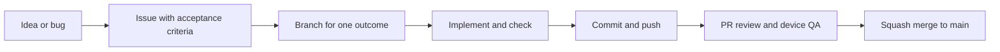

# Development workflow

GitHub repository: [avellir/Cal-Ai](https://github.com/avellir/Cal-Ai). `main` is the integration branch. Work moves through an issue, a short-lived branch, a pull request, verification and a squash merge.



## Start one task

Choose one issue with a demonstrable outcome. A small bug can go straight into an implementation task. For a multi-session feature, agree the decisions in a parent spec and split it into complete slices with explicit blockers. Each slice includes the UI/service/backend changes needed to demonstrate its outcome.

Use GitHub Issues for task scope, acceptance criteria, blockers and status. [priority.md](priority.md) records product order and links to the work; it is not a second daily task board. Active work is limited to one issue per person or agent. An optional GitHub Project can show Backlog, Ready, In progress, In review and Done; a project board is not required to start.

From a clean working tree:

```powershell
git switch main
git pull --ff-only origin main
git switch -c feat/123-retry-failed-ingredients
```

Use `feat/<issue>-<description>`, `fix/<issue>-<description>` or `chore/<issue>-<description>`. While a branch is active, make small commits after coherent working changes and push at session boundaries. Start new work from current `main` after the previous PR merges.

Keep existing uncommitted work on its branch while recovering it. Use a separate worktree for an unrelated task:

```powershell
git fetch origin
git worktree add ../Cal-Ai-workflow -b chore/123-workflow origin/main
```

## Implement and verify

Use Node 24 (see `.nvmrc`) and `npm ci`. Run focused behavior checks while implementing. The standard checks before marking a PR ready are:

```powershell
npm run typecheck
npm test -- --runInBand
node scripts/lint-changed.mjs origin/main
```

Changed-file lint includes committed, staged, unstaged and untracked source files, compares with the branch's merge base, and fails on ESLint errors. Existing unrelated full-app lint failures remain visible in the separate **Legacy lint audit** job. That audit is temporarily non-blocking; **Quality** requires typecheck, tests, changed-file lint and an iOS JavaScript/assets export. Full lint becomes required once its cleanup task is complete. Do not disable lint rules to hide new findings.

CI runs automatically for PRs and pushes to `main`; it also supports manual dispatch. It uses mocked tests and an Expo export without provider credentials, live meal writes or paid analysis requests. The export checks bundling; camera, permissions, keyboard, navigation and native behavior still need device QA when affected.

For a food-analysis behavior change, compare suitable saved inputs and add a regression for the actual failure. Fresh vision evaluation and live nutrition checks are separate, explicit provider operations. Keep credentials in local ignored environment files or Supabase secrets. Apply migrations and deploy Edge Functions as explicit release steps with the PR's version and validation recorded; a code merge alone does not update Supabase.

## Commit, review and merge

1. Inspect `git status` and the diff. Stage named files belonging to the task; inspect `git diff --cached` before committing. Keep credentials, generated output and unrelated work outside the commit.
2. Commit with a concrete message, for example `fix(nutrition): preserve healthy matches when one detail fails`, and push the branch using `git push -u origin <branch>`.
3. Open a draft PR early if useful. Link its issue with `Closes #123`. Use the PR template to show the change, before/after evidence, checks, release steps and material risks.
4. Review committed work against the issue and the fixed branch base, ideally in a fresh agent session. Check both repository standards and acceptance criteria. Record unperformed device/live checks honestly.
5. Mark ready when **Quality** passes and affected behavior has been exercised. For solo work, the author performs the QA/merge decision; requiring another person's approval is optional when another reviewer is available.
6. Squash merge the PR into `main`, then remove the merged remote branch. Delete a local branch only after checking that it is merged or that its work is preserved. Start the next task from updated `main`.

PR merging and production deployment remain explicit actions. CI is verification, not deployment.

## Configure GitHub once

After the workflow has run successfully, configure a rule for `main`: require a PR, require **Quality**, resolve review conversations, and prevent force pushes and deletion. For a solo repository, use zero mandatory external approvals; self-authored PRs cannot receive self-approval. Keep squash merge enabled. Add full lint as a required check after the existing lint findings are resolved.

The workflow files and templates activate when merged. A workflow file does not itself configure repository rules or create a Project board. GitHub administration settings are tracked separately in [the rollout checklist](docs/workflow/rollout.md).

## Working with a coding agent

Use a new task thread for a new issue, giving the issue and intended branch. Example:

> Implement issue #123 on a branch from current main. Read CONTRIBUTING.md and AGENTS.md. Preserve unrelated work, satisfy the acceptance criteria, run the appropriate checks, and prepare a reviewable PR. Report remaining device or deployment steps.

For large features, discuss decisions before creating the spec/tickets. Current Matt Pocock names are `to-spec` and `to-tickets`; older videos use PRD/issue names. Invoke only skills installed in the current client. Our branch naming and one-PR-per-task convention adapt his approach to this repository. [Research and primary sources](docs/workflow/matt-pocock-research.md).
